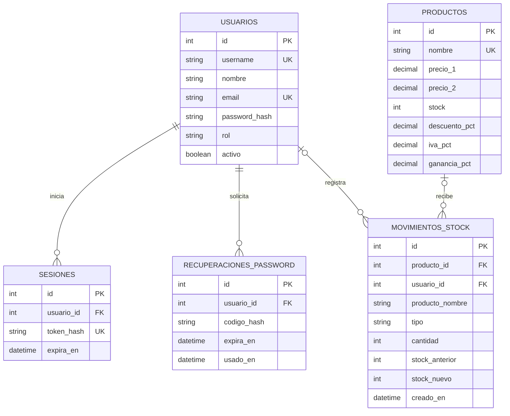

# Documentación técnica del sistema – Ferretería Avenida

## Descripción

Sistema web para administrar el inventario de una ferretería. Permite consultar artículos, administrar productos y precios, registrar entradas y salidas de existencias, gestionar usuarios con roles diferenciados y obtener reportes exportables.

## Mejora concreta propuesta sobre el sistema original

La mejora principal consiste en pasar de un panel de inventario de un solo operador a un sistema multiusuario con control de acceso, trazabilidad de movimientos de stock y generación de reportes.

La ampliación incorpora:

1. Inicio de sesión con validación de credenciales y sesiones.
2. ABM de usuarios con roles Administrador / Usuario.
3. Recuperación de contraseña en modalidad simulada para la instancia académica.
4. Registro de quién realizó cada entrada o salida de stock.
5. Reportes de inventario visibles en pantalla y exportables a Excel o CSV.
6. Validación centralizada de datos y separación del servidor, rutas, middleware y persistencia.

## Requisitos del documento PPS / TFI y estado en esta versión

| Requisito | Implementación |
|---|---|
| Sistema web real y ejecutable | Aplicación Express servida desde `public/`. |
| Código propio, ordenado y evaluable | Backend separado en `server.js`, `db.js`, `src/middleware`, `src/routes` y `src/services`; interfaz en `public/`. |
| Persistencia real | SQLite en archivo dentro de `DATA_DIR` o del Volume de Railway. |
| Gestión de usuarios (ABM) | Endpoints y pantalla `usuarios.html`. |
| Login con validación | `POST /api/auth/login`, contraseña verificada con bcrypt. |
| Roles diferenciados | `admin` y `usuario`, con autorización también en el servidor. |
| Recuperación de contraseña | Flujo simulado con código de un solo uso que vence en 15 minutos y se muestra en logs. |
| CRUD de dos entidades | ABM de `productos` y `usuarios`. |
| Claves primarias y foráneas | PK en todas las tablas; FK en sesiones, recuperaciones y movimientos. |
| Integridad de datos | Restricciones SQL, validaciones de API, claves únicas y foreign keys activadas. |
| Diseño modular / capas | Servidor, rutas, middleware, servicio de inicialización y acceso a datos separados. |
| Manejo de errores | Respuestas HTTP controladas y middleware de errores. |
| Visualización de reportes | `reportes.html`, con indicadores y movimientos. |
| Exportación | Exportación del inventario en Excel y CSV. |

La conformidad académica final, la evaluación del código y la aceptación de la modalidad corresponden al equipo docente y al tutor. Esta tabla describe lo implementado en el repositorio, no reemplaza la evaluación ni las instancias de seguimiento.

## Arquitectura

- `server.js`: configuración de Express, middlewares y montaje de rutas.
- `db.js`: conexión SQLite, esquema y migraciones aditivas.
- `src/middleware/auth.middleware.js`: autenticación de sesión y autorización por rol.
- `src/routes/auth.routes.js`: login, logout, consulta de sesión y recuperación.
- `src/routes/usuarios.routes.js`: ABM de usuarios.
- `src/routes/productos.routes.js`: ABM de productos, ajustes de stock e importación Excel.
- `src/routes/reportes.routes.js`: indicadores, movimientos y exportación.
- `src/services/bootstrap.service.js`: administrador inicial y carga inicial del catálogo.
- `public/`: pantallas de acceso, inventario, usuarios y reportes.

## Modelo de datos (entidad / relación)

### Relaciones y reglas

- Un usuario puede generar varias sesiones y varias recuperaciones de contraseña.
- Un usuario puede registrar muchos movimientos de stock.
- Un producto puede tener muchos movimientos de stock.
- Al eliminar un usuario, sus sesiones y recuperaciones se eliminan por cascada; el movimiento histórico se conserva y su referencia al usuario pasa a `NULL`.
- Al eliminar un producto, el movimiento histórico se conserva con el nombre del producto como fotografía del dato al momento del movimiento; la referencia al producto pasa a `NULL`.
- Los identificadores son claves primarias. `username`, `email`, `token_hash` y `nombre` de producto tienen restricciones de unicidad donde corresponde.
- Los reportes calculan totales en las consultas; no se almacenan valores agregados duplicados.

## Seguridad y validaciones

- Contraseñas cifradas mediante bcrypt (hash con salt).
- Token de sesión aleatorio; se guarda su SHA-256, no el token en texto plano.
- Cookie HttpOnly y SameSite=Lax; Secure en entorno de producción.
- Limitación de intentos de login y recuperación.
- Operaciones administrativas protegidas en backend; ocultar botones en la interfaz no es el control de seguridad.
- Stock entero y no negativo; precio no negativo; porcentajes dentro de rangos definidos.
- No se permite desactivar o eliminar el último administrador activo.

## Reportes

La pantalla de reportes muestra total de productos, unidades, productos con stock bajo y valor estimado del inventario. El valor se calcula como `Precio 1 × Stock` y se identifica como estimación. Además, se presenta el historial de movimientos con usuario, tipo, cantidad y stock resultante.

Las exportaciones incluyen los productos ordenados por nombre y sus precios, existencias, porcentajes y valor en stock.

## Alcance pendiente para una versión de uso comercial

La recuperación de contraseña de esta versión es simulada. Debe integrarse un proveedor de correo electrónico antes de usar el mecanismo en un entorno con usuarios reales. También se debe verificar en el propio proyecto Railway que el Volume esté montado y que el dominio público use HTTPS.
